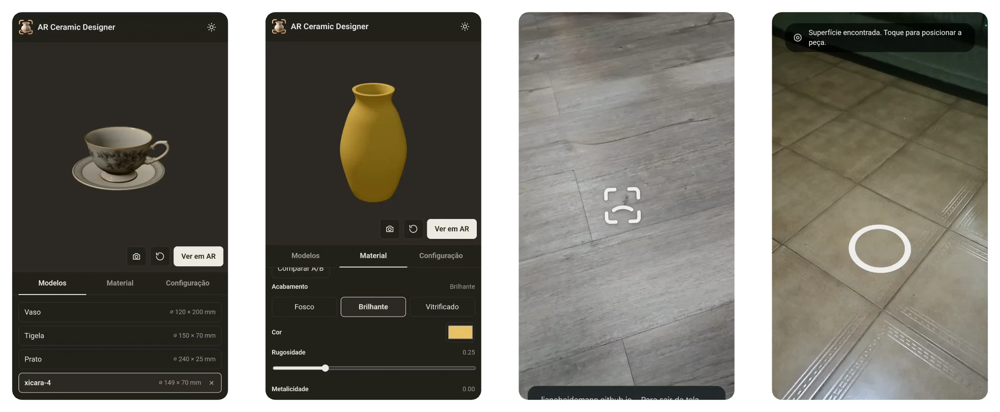

  

<h1 align="center">AR Ceramic Designer</h1>

  
  
  
  
  
 
  
  
  

Web app to view ceramic pieces in 3D, customize their finish, compare variants and place them at real size in augmented reality.

  

## Features

- 3D viewer with orbit, zoom and reset (mouse, touch and keyboard).
- Finishes (matte, glossy, glazed), color, roughness and metalness, with A/B comparison side by side.
- Augmented reality (WebXR): place the piece on a detected surface, move it, turn it (‹ ›) and adjust its height (− +).
- Import `.glb` models; set any piece's real size; see file size, triangles and textures under **Details**.
- Undo and redo material and size edits (header buttons, Ctrl+Z / Ctrl+Shift+Z).
- Save a PNG of the 3D view.

## Requirements

| Use       | Needs                                                                                                                  |
| :-------- | :--------------------------------------------------------------------------------------------------------------------- |
| 3D viewer | A browser with WebGL 2 (Chrome, Edge, Firefox, Safari 15+)                                                             |
| AR        | An [ARCore-supported](https://developers.google.com/ar/devices) Android phone, Chrome 81+, HTTPS and camera permission |

iOS Safari has no WebXR yet, so iPhone and iPad get the 3D viewer only. AR is tested on the Galaxy S23 Ultra (Chrome, Android 16).

## 3D files

Single binary `.glb` (glTF 2.0) with embedded textures; Meshopt compression is supported, Draco and KTX2 are not. Details in [`app/README.md`](app/README.md#accepted-files).

## Known limitations

- On imported models, the finish controls tint the file's own textures.
- PNG capture covers the 3D view only, not the AR camera.
- Performance on phones is not measured yet.

## License

[MIT](LICENSE). Default models generated by the author with Tripo AI.

## Documentation

[Developer guide](app/README.md) · [Step-by-step guide](docs/step-by-step.md) · [Development plan](docs/development-plan.md) · [References](docs/references.md)
