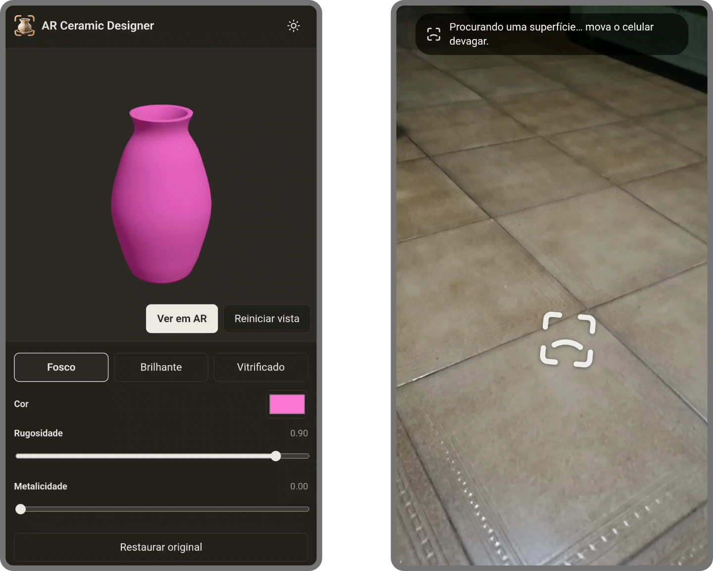

  

<h1 align="center">AR Ceramic Designer</h1>

  
  
  
    
  
 
  
  
  

Interface web interativa, publicada no GitHub Pages, para explorar modelos de cerâmica em 3D, personalizar materiais e comparar acabamentos. Em dispositivos compatíveis, permite visualizar as peças em realidade aumentada.

  

## Tecnologias

| Tecnologia | Utilização |
| :--- | :--- |
| [TypeScript](https://www.typescriptlang.org/) | Linguagem principal, com tipagem estática. |
| [React](https://react.dev/) | Interface, componentes e gerenciamento de estado. |
| [Three.js](https://threejs.org/) | Renderização e interação com os modelos 3D. |
| [Vite](https://vite.dev/) | Ambiente de desenvolvimento e build. |
| [Vitest](https://vitest.dev/) | Testes automatizados. |
| [Oxlint](https://oxc.rs/docs/guide/usage/linter.html) | Análise estática do código. |
| [Prettier](https://prettier.io/) | Formatação de código. |
| [GitHub Actions](https://github.com/features/actions) | Workflows de integração e deploy. |
| [WebXR](https://developer.mozilla.org/en-US/docs/Web/API/WebXR_Device_API) | Recursos de realidade aumentada no navegador. |

## Documentação

- [Guia passo a passo](docs/step-by-step.md)
- [Plano de desenvolvimento](docs/development-plan.md)
- [Referências](docs/references.md)

## Demo

[🔗 Acessar a aplicação](https://lianeheidemann.github.io/ar-ceramic-designer/)
