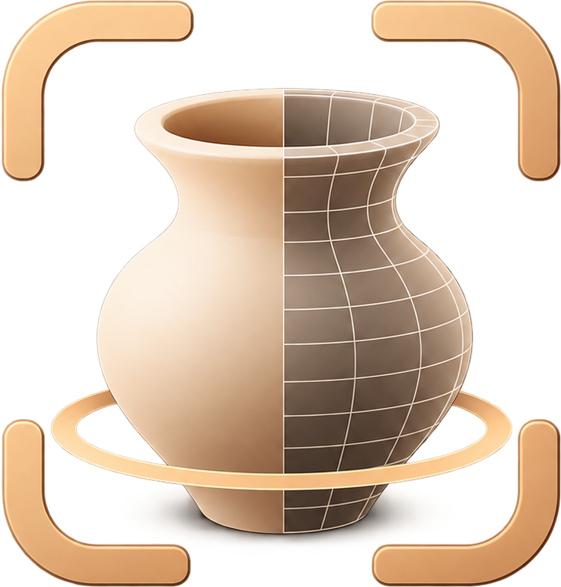

<p align="center">
  
</p>

<h1 align="center">AR Ceramic Designer</h1>

<p align="center">
  
  
  
    
  
<br>
  <a href="https://github.com/lianeheidemann/ar-ceramic-designer/actions/workflows/ci.yml?query=branch%3Adevelop"></a>
  <a href="https://github.com/lianeheidemann/ar-ceramic-designer/actions/workflows/deploy.yml"></a>
  <a href="https://lianeheidemann.github.io/ar-ceramic-designer/"></a>
</p>

Aplicação web para visualizar e personalizar objetos de cerâmica em 3D e posicioná-los em realidade aumentada (WebXR) em dispositivos Android compatíveis.

## Tecnologias

### Aplicação

| Tecnologia | Utilização |
| :--- | :--- |
| [TypeScript](https://www.typescriptlang.org/) | Linguagem principal, com tipagem estática. |
| [React](https://react.dev/) | Interface, componentes e gerenciamento de estado. |
| [Three.js](https://threejs.org/) | Renderização e interação com os modelos 3D. |
| [Vite](https://vite.dev/) | Ambiente de desenvolvimento e build. |

### Ferramentas de desenvolvimento

| Ferramenta | Utilização |
| :--- | :--- |
| [Vitest](https://vitest.dev/) | Testes automatizados. |
| [Oxlint](https://oxc.rs/docs/guide/usage/linter.html) | Análise estática do código. |
| [Prettier](https://prettier.io/) | Formatação de código. |
| [GitHub Actions](https://github.com/features/actions) | Workflows de integração e deploy. |

> **WebXR:** tecnologia prevista para realidade aumentada; não representa uma funcionalidade já concluída.

## Requisitos

- Node.js LTS (testado com Node 22) e npm.

### Realidade aumentada

- Android com Chrome atualizado e o app **Google Play Services para RA** (ARCore) instalado.
- Abrir o app por HTTPS (ex.: GitHub Pages) e permitir o uso da câmera.
- Em navegadores sem WebXR (desktop, iPhone), o visualizador 3D continua disponível e o app explica por que o AR não está disponível.

## Estrutura

```text
app/    # código da aplicação (Vite + React + Three.js)
docs/   # documentação e planejamento
```

## Comandos

Rode os comandos dentro da pasta `app/`:

```bash
cd app
npm install          # instalar dependências
npm run dev          # servidor de desenvolvimento
npm run build        # checagem de tipos + build de produção em dist/
npm run preview      # servir o build de produção localmente
npm run lint         # lint (oxlint)
npm test             # testes unitários (Vitest)
npm run format       # formatar com Prettier
```


## Documentação

- [Guia passo a passo](docs/step-by-step.md)
- [Plano de desenvolvimento](docs/development-plan.md)
- [Referências](docs/references.md)
