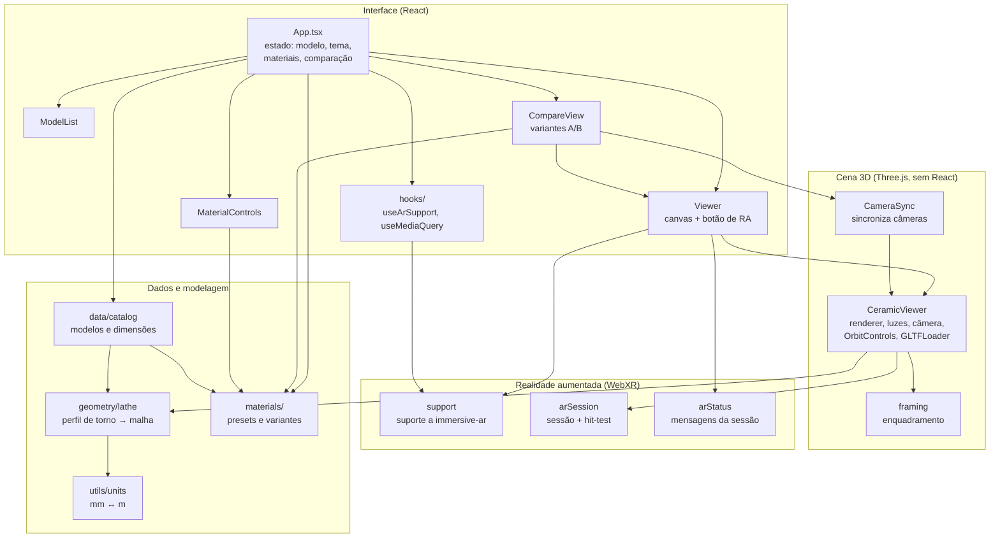

# app

Código-fonte da aplicação web: React + Three.js, empacotada com Vite e publicada no GitHub Pages (`base: '/ar-ceramic-designer/'` em `vite.config.ts`).

## Arquitetura



`App` guarda todo o estado e repassa aos componentes. Cada `Viewer` cria um `CeramicViewer`, que monta a cena: as peças do catálogo são geradas a partir de um perfil de torno (`geometry/lathe`) ou carregadas de um arquivo `.glb`. Ao entrar em RA, o `CeramicViewer` abre a sessão WebXR (`ar/arSession`), que usa o `hit-test` para posicionar a peça em uma superfície real. Os tipos compartilhados (`types/ceramic`) são usados por quase todos os módulos e foram omitidos do diagrama.

## Estrutura

| Pasta / arquivo | Conteúdo |
| :--- | :--- |
| `src/main.tsx`, `src/App.tsx` | Ponto de entrada e componente raiz: estado do modelo selecionado, tema, materiais personalizados e modo de comparação. |
| `src/components/` | Componentes React da interface: visualizador (`Viewer`), lista de modelos, controles de material, comparação lado a lado (`CompareView`) e ícones de status da RA. |
| `src/viewers/` | Cena Three.js independente do React (`CeramicViewer`): renderização, luzes, câmera, controles de órbita, enquadramento do modelo e sincronização de câmeras na comparação. |
| `src/ar/` | Realidade aumentada via WebXR: verificação de suporte do navegador, sessão `immersive-ar` com `hit-test` para posicionar a peça em superfícies e mensagens de status exibidas durante a sessão. |
| `src/geometry/` | Geração das peças por torno (lathe): suaviza o perfil externo e cria a parede com espessura. |
| `src/materials/` | Predefinições de acabamento (fosco, brilhante, vitrificado) e materiais iniciais das variantes A/B da comparação. |
| `src/data/` | Catálogo de modelos de cerâmica e suas dimensões. |
| `src/hooks/` | Hooks React: suporte a RA e media queries. |
| `src/types/` | Tipos compartilhados (modelos, materiais, perfis). |
| `src/utils/` | Conversão de unidades: as medidas são registradas em milímetros, e Three.js/WebXR usam metros. |
| `public/` | Ícones do site e pastas reservadas para modelos e texturas. |

Os arquivos `*.test.ts` ficam ao lado do código que testam.

## Comandos

```bash
npm install
npm run dev        # servidor de desenvolvimento
npm run build      # checagem de tipos + build de produção
npm test           # testes (Vitest)
npm run lint       # análise estática (Oxlint)
npm run format     # formatação (Prettier)
```

A realidade aumentada só funciona em HTTPS. Para testar no celular, acesse o servidor de desenvolvimento por uma conexão segura ou use a versão publicada.
