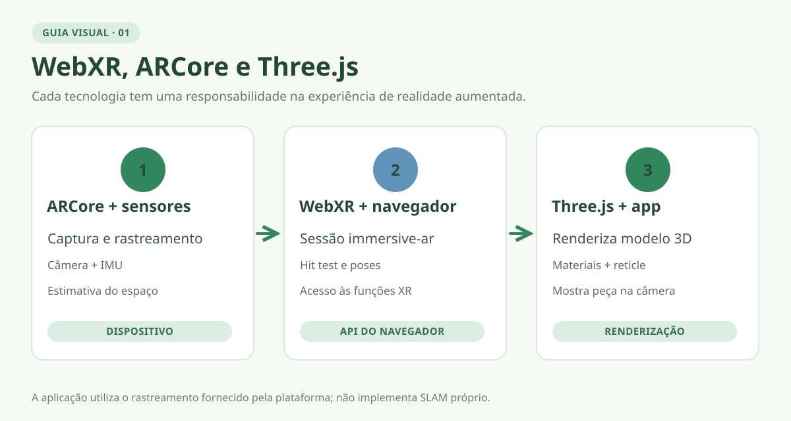
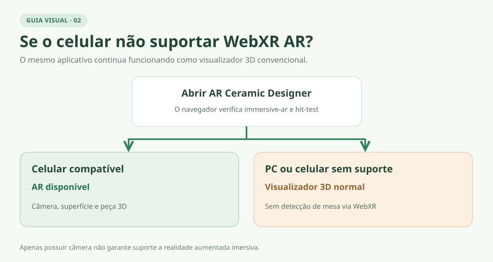
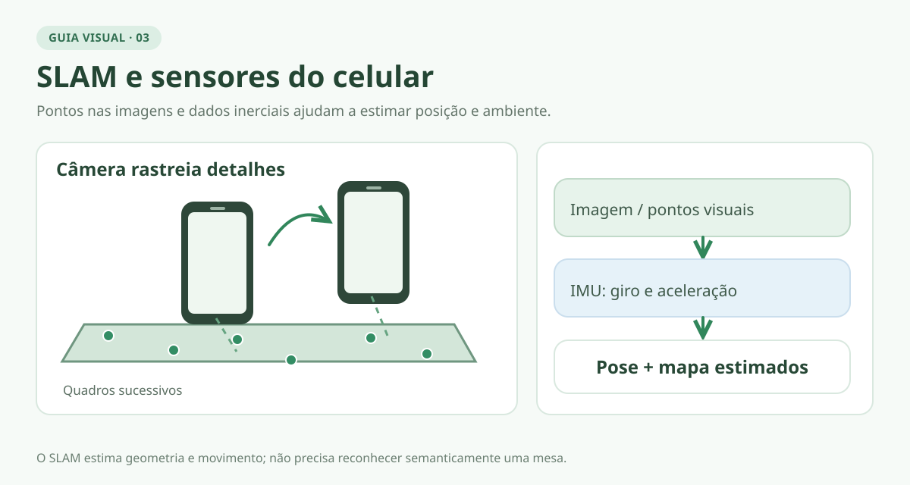
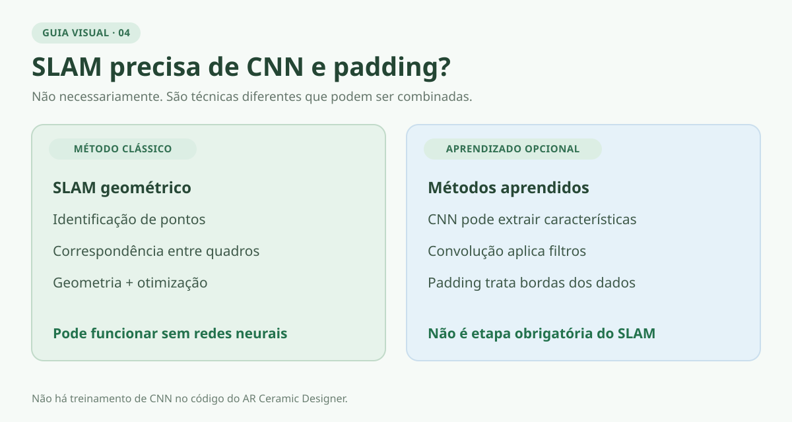
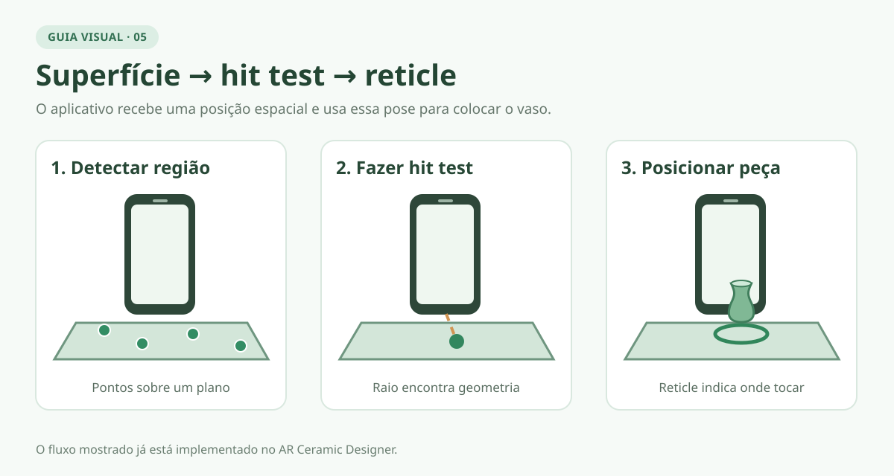
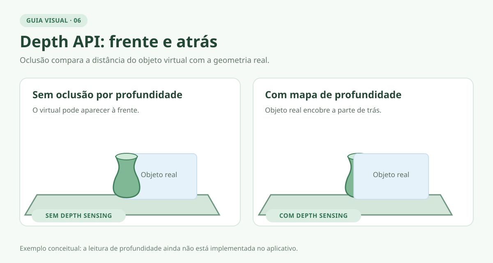
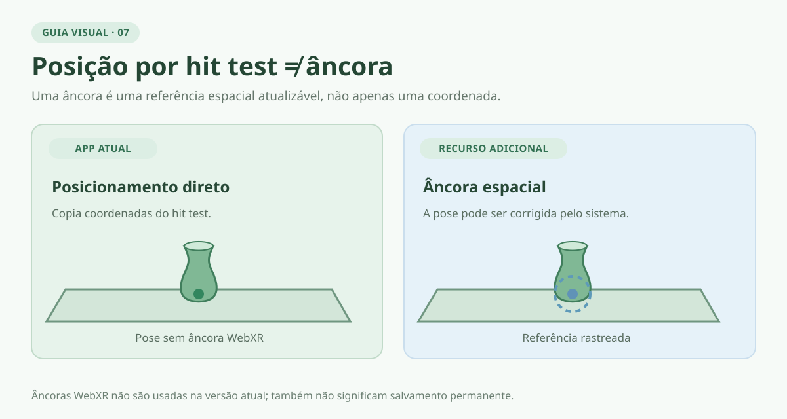
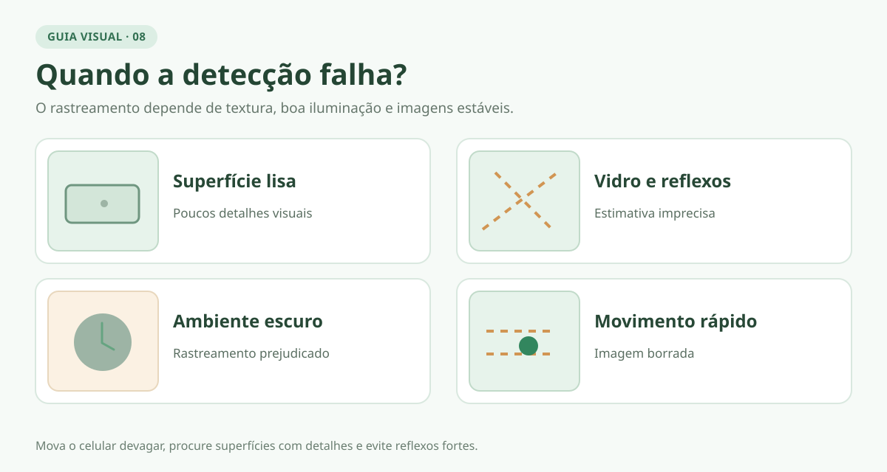

# WebXR e ARCore — Guia de funcionamento e compatibilidade

> **Ilustrações:** oito diagramas vetoriais originais acompanham os conceitos. Recursos conceituais não são necessariamente implementados no aplicativo.

## 1. WebXR, ARCore e Three.js: quem faz o quê?

- **WebXR:** conjunto de APIs web que permite ao navegador iniciar sessões de realidade aumentada (AR) ou virtual (VR), acompanhar a posição do usuário e obter informações espaciais quando suportadas.
- **ARCore:** tecnologia do Google que combina imagens da câmera, sensores e estimativas geométricas para rastrear o celular e entender partes do ambiente. No Chrome para Android compatível, fornece a base de rastreamento utilizada pelo WebXR AR.
- **Three.js:** biblioteca JavaScript que renderiza a peça cerâmica 3D, seus materiais e sua posição na cena.
- **React/TypeScript:** estrutura da interface e da lógica do aplicativo; não realiza por si só o mapeamento do ambiente.

**Exemplo:** a câmera observa uma mesa → o ARCore estima o espaço → o WebXR fornece uma posição de contato → o Three.js desenha o vaso sobre a mesa.

**Diferença importante:** ter WebXR disponível não significa que *todos* os recursos de um aplicativo Android feito diretamente com ARCore estejam disponíveis no navegador.

## 2. Compatibilidade: o que acontece ao abrir o aplicativo?

Para **AR imersiva no Android**, normalmente são necessários: (1) celular certificado para ARCore, (2) Google Play Services para RA instalado/ativado, (3) navegador compatível — principalmente Chrome no Android —, (4) conexão HTTPS (ou contexto local seguro para desenvolvimento) e (5) permissão para a sessão/câmera quando solicitada.

| Dispositivo / situação | Visualização 3D comum | AR sobre a câmera |
| --- | --- | --- |
| Android com ARCore, Chrome e requisitos atendidos | Sim | Pode funcionar via WebXR `immersive-ar` e `hit-test` |
| Android sem ARCore ou sem suporte WebXR AR no navegador | Sim, se houver WebGL 2 | Indisponível no fluxo WebXR usado pelo projeto |
| Computador comum, sem hardware XR apropriado | Sim, via navegador compatível | Normalmente indisponível; **não** detecta uma mesa usando apenas uma webcam comum |
| Computador com headset XR e navegador compatível | Sim | Depende das capacidades de AR e do navegador do headset |
| iPhone/iPad com Safari | Sim, no visualizador WebGL compatível | O fluxo `immersive-ar` deste projeto não é suportado nativamente; AR Quick Look é outra tecnologia, **não implementada aqui** |

**Comportamento atual do AR Ceramic Designer:** se a AR não estiver disponível, o aplicativo informa a incompatibilidade e **mantém o visualizador 3D utilizável**. Uma falha ou negação de permissão na abertura da sessão também produz uma mensagem de erro. Não é correto afirmar que qualquer navegador com câmera consegue executar AR.

**Como verificar:** a aplicação testa `navigator.xr` e `navigator.xr.isSessionSupported('immersive-ar')`; durante a sessão também exige o recurso `hit-test`. A disponibilidade é determinada pelo conjunto **dispositivo + sistema + navegador + recursos solicitados**, e pode variar com atualizações.

**Referências:** [requisitos WebXR no ARCore](https://developers.google.com/ar/develop/webxr/requirements), [dispositivos certificados](https://developers.google.com/ar/devices), [compatibilidade WebXR/MDN](https://developer.mozilla.org/en-US/docs/Web/API/WebXR_Device_API), [AR Quick Look/Apple](https://developer.apple.com/quick-look-gallery/).

## 3. O que significa `immersive-ar`?

É o **modo de sessão WebXR** que apresenta elementos virtuais alinhados ao ambiente físico. Em um celular, o usuário vê a imagem capturada pela câmera e a peça 3D posicionada nela.

- `inline`: conteúdo XR apresentado dentro da página; **não equivale** à detecção de superfícies por ARCore.
- `immersive-vr`: experiência imersiva de realidade virtual.
- `immersive-ar`: experiência de realidade aumentada imersiva.

No projeto, a sessão solicita `immersive-ar` com **`hit-test` obrigatório** e **`dom-overlay` opcional**. O `dom-overlay` permite exibir os controles HTML sobre a visualização AR, quando aceito pelo navegador.

**Arquivos atuais:** [`support.ts`](../app/src/features/ar/support.ts) (verificação de suporte) e [`arSession.ts`](../app/src/features/ar/arSession.ts) (sessão AR).

## 4. Como o celular detecta uma superfície?

A ideia central é acompanhar pontos visuais do ambiente enquanto o dispositivo se movimenta. A câmera, sozinha, não fornece automaticamente uma malha 3D perfeita da sala.

1. **Câmera:** observa detalhes reconhecíveis, como bordas, texturas, cantos e contrastes (*feature points*).
2. **Movimento:** ao deslocar o telefone, a posição aparente desses pontos muda entre os quadros.
3. **Sensores:** o giroscópio e o acelerômetro ajudam a estimar rotação e movimento.
4. **Rastreamento espacial:** o sistema combina dados visuais e inerciais para estimar a posição/orientação da câmera e reconstruir informações sobre o espaço.
5. **Superfícies:** agrupamentos de pontos compatíveis com um mesmo plano podem indicar mesa, chão ou parede.
6. **Hit test:** o navegador pode obter um ponto onde um raio virtual encontra uma geometria rastreada.
7. **Renderização:** o Three.js coloca o modelo nas coordenadas estimadas.

O ARCore geralmente reconhece **geometria**, não o significado semântico: detectar um plano horizontal **não é o mesmo** que classificar um objeto como “mesa”.

### SLAM — *Simultaneous Localization and Mapping*

SLAM significa **localização e mapeamento simultâneos**: o sistema tenta responder, ao mesmo tempo, **“onde está o celular?”** e **“como está organizado o ambiente ao redor?”**. No ARCore, isso inclui rastreamento de pontos visuais e fusão com medições da unidade inercial (IMU).

- **Giroscópio:** mede a velocidade angular; ajuda a detectar quando o celular gira ou muda de orientação.
- **Acelerômetro:** mede a aceleração específica, incluindo o efeito da gravidade; ajuda na estimativa de movimento e da direção vertical.
- **IMU:** unidade que reúne esses sensores e fornece medições de alta frequência. Os sensores **não substituem** a câmera: estimativas inerciais isoladas acumulam erro (*drift*).

### SLAM usa machine learning, convoluções e padding?

**Não necessariamente.** SLAM é uma **família de métodos**, não uma arquitetura específica de rede neural:

- Existem métodos clássicos de visão computacional e otimização geométrica que **não precisam de redes neurais**.
- Existem abordagens modernas que usam **machine learning/deep learning** para detectar características, estimar profundidade ou associar pontos.
- **Convolução** é uma operação comum em redes neurais convolucionais (CNNs); **padding** adiciona bordas aos dados para controlar o tamanho espacial dos mapas de características. São técnicas de processamento de imagens/redes neurais, **não etapas obrigatórias do SLAM**.
- O Google descreve o rastreamento do ARCore como combinação de pontos visuais e sensores inerciais, **sem afirmar que seu SLAM depende especificamente de CNN ou padding**. A implementação interna completa não deve ser deduzida apenas da API.
- A **Depth API** do ARCore, por outro lado, usa estimativa de profundidade por movimento e **pode usar machine learning seletivamente** para aperfeiçoar resultados. Isso não significa que o código do aplicativo treine ou execute uma CNN própria.

**Fontes:** [fundamentos do ARCore](https://developers.google.com/ar/develop/fundamentals) e [Depth API](https://developers.google.com/ar/develop/depth).

## 5. Plane detection, hit test, reticle e posicionamento

Estes termos representam **etapas diferentes**, embora trabalhem juntos:

| Termo | Explicação simples | Aplicação à cerâmica |
| --- | --- | --- |
| **Plane detection** | Estimativa de superfícies planas (horizontais/verticais) a partir do ambiente rastreado | O sistema identifica uma região compatível com o tampo de uma mesa |
| **Hit test** | Testa a interseção de um raio virtual com a geometria que o sistema disponibiliza | Encontra um ponto adequado para colocar o vaso |
| **Pose** | Posição **e** orientação de algo no espaço | Informa onde ocorreu a interseção e como está orientada |
| **Reticle** | Marcador visual de pré-posicionamento, frequentemente um anel ou mira | Mostra na tela o local onde o toque pode colocar o vaso |
| **Anchor (âncora)** | Referência espacial rastreada que ajuda a manter um objeto associado ao ambiente conforme o rastreamento é corrigido | Ajuda a manter a peça estável sobre a superfície |

**Importante:** *plane detection* dentro do ARCore e a exposição de planos diretamente ao código JavaScript são coisas diferentes. O **WebXR Plane Detection API** aparece como **Developer Trial** na comparação oficial do Google; o **WebXR Hit Test** já pode ser utilizado sem depender dessa API experimental de listagem de planos.

### Sequência real no AR Ceramic Designer

1. O usuário abre **View in AR** em um aparelho compatível.
2. A sessão WebXR solicita `hit-test` e acompanha um raio associado à direção central da visualização.
3. Quando há uma interseção, o aplicativo mostra um **anel branco (reticle)** na posição encontrada.
4. Ao tocar, o aplicativo transfere a **posição** do anel para o modelo 3D, que passa a aparecer no local.
5. O usuário pode girar a peça, modificar sua altura/tamanho nos controles existentes ou tocar para escolher outra posição.

**No código atual:** o anel é uma `RingGeometry` no Three.js, a posição vem de `getHitTestResults()` e a orientação de giro da cerâmica é controlada pelos botões do app. O recurso **WebXR Anchors não está implementado**: a posição é usada diretamente, sem criar um `XRAnchor`. A peça também **não** permanece no mundo físico após terminar e reabrir a sessão.

**Arquivo:** [`arSession.ts`](../app/src/features/ar/arSession.ts). O fluxo acima descreve a implementação existente; não é uma proposta de alteração.

## 6. O que é a Depth API?

A **Depth API** fornece estimativas de **distância entre a câmera e partes da cena**. Uma *depth map* (mapa de profundidade) armazena valores de distância para regiões/pixels da imagem.

Exemplos de uso:

- **Oclusão:** uma peça virtual pode aparecer parcialmente **atrás** de um objeto real, quando a cena indica que o objeto físico está mais próximo da câmera.
- **Interações geométricas:** melhorar contato/interseções com formas não planas; efeitos e colisões dependem de lógica adicional.
- **Realismo:** melhorar o alinhamento espacial de alguns efeitos.

**Precisa de LiDAR?** Não necessariamente. O ARCore pode estimar profundidade a partir da câmera RGB e do movimento, aproveitando sensores de profundidade dedicados (por exemplo, ToF) quando presentes e compatíveis. **Nem todo dispositivo ARCore oferece Depth API**; suporte ao recurso deve ser conferido separadamente.

**Depth API do ARCore ≠ WebXR Depth Sensing:** o primeiro é o recurso da plataforma; o segundo é a interface web que, quando suportada e solicitada, pode disponibilizar profundidade ao JavaScript.

**No projeto atual:** não há solicitação de `depth-sensing` ou implementação de oclusão por mapa de profundidade. O posicionamento funciona por `hit-test`, **sem precisar** que o aplicativo leia a Depth API.

**Fontes:** [ARCore Depth API](https://developers.google.com/ar/develop/depth) e [WebXR Depth Sensing/MDN](https://developer.mozilla.org/en-US/docs/Web/API/XRDepthInformation).

## 7. O que é uma âncora (*anchor*)?

Uma **âncora espacial** conecta uma referência virtual a uma posição rastreada no mundo. Conforme o sistema corrige seu mapa, a referência pode ser atualizada para reduzir a sensação de que o objeto está deslizando.

Não confundir com **salvar permanentemente** a posição: uma âncora comum não implica persistência entre sessões, compartilhamento entre dispositivos ou armazenamento em nuvem. Essas possibilidades dependem de mecanismos adicionais.

O **AR Ceramic Designer** posiciona a cerâmica com base no `hit-test`, mas **não cria uma âncora WebXR** na versão documentada.

## 8. Recursos da tabela ARCore × WebXR

A tabela abaixo reproduz os **tipos de recurso e o status informado pelo Google para o Chrome/WebXR** na página de comparação consultada. O status corresponde à **plataforma**, não ao código do aplicativo; pode mudar com novas versões.

| Recurso | O que faz | Status do Google para Chrome/WebXR | Uso atual no projeto |
| --- | --- | --- | --- |
| **Hit Test** | Encontra interseções com geometria estimada | **Shipped** (disponibilizado) | **Sim** — posicionamento |
| **Anchors** | Mantém uma referência espacial rastreada | **Shipped** | **Não** — sem `XRAnchor` |
| **Depth API / Depth Sensing** | Estima distância e permite efeitos como oclusão | **Shipped** | **Não** — sem leitura de profundidade |
| **Plane Detection** | Expõe planos detectados e suas informações geométricas | **Developer Trial** (teste para desenvolvedores) | **Não** usa a API explícita de planos; usa hit test |
| **Lighting Estimation** | Estima a iluminação do ambiente para iluminar objetos virtuais | **Shipped** | **Não** usa o módulo WebXR de estimativa de luz |
| **Augmented Faces** | Rastreia geometria/posição de rostos para filtros e efeitos faciais | **Não disponibilizado** nessa comparação WebXR/Chrome | **Não** |
| **Augmented Images** | Reconhece imagens de referência (cartazes, etiquetas etc.) e associa conteúdo virtual | **Não disponibilizado** nessa comparação WebXR/Chrome | **Não** |
| **Instant Placement** | Permite posicionamento inicial aproximado antes de obter rastreamento geométrico completo | **Não disponibilizado** nessa comparação WebXR/Chrome | **Não** |

**Tradução dos status:** *Shipped* = recurso lançado no Chrome para os ambientes compatíveis, **não** garantia de funcionamento em todos os celulares. *Developer Trial* = acesso experimental/limitado para desenvolvedores, não disponibilidade universal. O símbolo de indisponível na tabela do Google significa **não oferecido nessa integração WebXR/Chrome**, não que o ARCore nativo não possua o recurso.

**Esclarecimentos adicionais:**

- **Lighting Estimation:** uma peça poderia refletir aproximadamente a luz real do local; isso exige integração do recurso e ajustes de renderização.
- **Augmented Faces:** usado para máscaras e filtros faciais; não é relevante para posicionar cerâmicas sobre mesas.
- **Augmented Images:** usaria uma imagem impressa como referência; diferente de encontrar superfícies planas.
- **Instant Placement:** apresenta inicialmente uma posição/distância estimada e a refina quando o rastreamento melhora; diferente de aguardar um hit test válido.

**Fonte da tabela:** [Google — WebXR compared to ARCore](https://developers.google.com/ar/develop/webxr/arcore-comparison). Verifique novamente a página oficial antes de planejar um recurso novo.

## 9. Limitações práticas da detecção

| Situação | Possível efeito |
| --- | --- |
| Superfície lisa, uniforme ou sem textura (ex.: mesa branca) | Poucos pontos visuais; detecção lenta ou instável |
| Vidro, espelho ou material muito reflexivo | Estimativas de superfície/profundidade pouco confiáveis |
| Pouca luz, sombras fortes ou movimento muito rápido | Rastreamento visual piora |
| Câmera obstruída, fora de foco ou com reflexos | Perda de referências espaciais |
| Pouco deslocamento do celular | Pode demorar a estimar geometria e profundidade |
| Objetos em movimento | Parte do mapa pode ficar inconsistente |
| Dispositivo aquecido, modelo 3D pesado | Queda de FPS, maior latência e pior experiência |
| Permissão recusada, navegador incompatível ou página insegura | A sessão AR não inicia |

**Boas práticas de uso:** testar em ambiente iluminado, mover o aparelho lentamente, apontar para uma região com detalhes visuais e aguardar o anel aparecer antes de tocar. Não prometer precisão metrológica: **a escala 3D é representada em metros, mas a exatidão física observada depende da calibração, do dispositivo e da qualidade do rastreamento**.

## 10. Resumo: o que o aplicativo já faz?

| Funcionalidade | Situação na branch `develop` |
| --- | --- |
| Visualizar e personalizar modelos cerâmicos em 3D no navegador | **Implementado** |
| Verificar suporte a AR e manter modo 3D como alternativa | **Implementado** |
| Iniciar sessão `immersive-ar` no dispositivo compatível | **Implementado** |
| Detectar ponto de posicionamento com `hit-test` | **Implementado** |
| Exibir marcador (reticle) e posicionar peça por toque | **Implementado** |
| Girar e ajustar a peça com os controles existentes | **Implementado** |
| Criar âncoras WebXR | **Não implementado** |
| Ler mapas de profundidade WebXR | **Não implementado** |
| Consultar lista explícita de planos via Plane Detection API | **Não implementado** |
| Iluminação estimada via WebXR Lighting Estimation | **Não implementado** |
| Usar CNN própria ou treinar modelo de ML no app | **Não implementado e não necessário** para o fluxo atual |

A colocação em AR já foi testada no **Galaxy S23 Ultra (Chrome/Android 16)**, conforme o [plano](development-plan.md) e o [guia passo a passo](step-by-step.md). Isso comprova o comportamento nesse aparelho, **não** em todos os dispositivos.

## Referências oficiais e complementares

1. [Google — ARCore: Fundamental concepts](https://developers.google.com/ar/develop/fundamentals) — SLAM, pontos, sensores, planos, hit tests e âncoras.
2. [Google — WebXR compared to ARCore](https://developers.google.com/ar/develop/webxr/arcore-comparison) — comparação dos oito recursos da tabela.
3. [Google — WebXR requirements](https://developers.google.com/ar/develop/webxr/requirements) — compatibilidade, navegador e HTTPS.
4. [Google — ARCore supported devices](https://developers.google.com/ar/devices) — certificação e capacidades dos celulares.
5. [Google — Depth API](https://developers.google.com/ar/develop/depth) — mapas de profundidade, sensores e uso seletivo de ML.
6. [MDN — WebXR Device API](https://developer.mozilla.org/en-US/docs/Web/API/WebXR_Device_API) — modos de sessão e módulos.
7. [W3C — WebXR Device API](https://www.w3.org/TR/webxr/) — especificação.
8. [Immersive Web — Hit Test](https://immersive-web.github.io/hit-test/) — especificação de interseções.
9. [Apple — AR Quick Look](https://developer.apple.com/quick-look-gallery/) — alternativa de AR para dispositivos Apple.

---

*Este guia descreve os conceitos, os requisitos conhecidos e o estado observado da implementação em 30/10/2026. APIs experimentais, suporte de navegadores e disponibilidade por aparelho devem ser sempre revalidados.*
